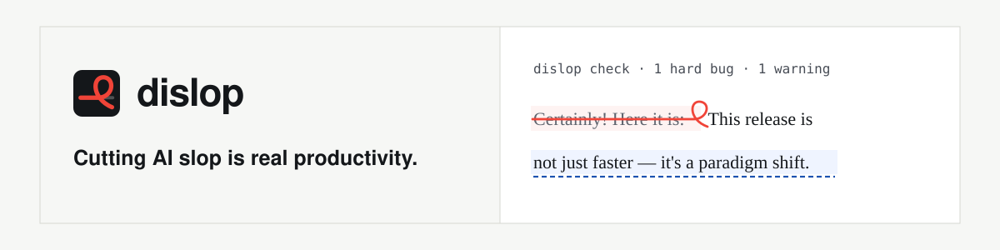

  <picture>
    <source media="(prefers-color-scheme: dark)" srcset="../assets/banner-dark.svg">
    
  </picture>

  <a href="./README.zh-CN.md">简体中文</a> ·
  <a href="https://dislop.com/awesome/">Filter at dislop.com/awesome</a> ·
  <a href="https://dislop.com/#workbench">Try a draft</a> ·
  <a href="https://dislop.com/awesome/index.json">JSON</a> ·
  <a href="../README.md">dislop repo</a>

# Awesome Anti-Slop

Cutting AI slop is real productivity. 90 tools, linters, style guides, UI rules, PR policies, and papers in English and Chinese, including established projects like Vale and Impeccable.

Every link, star count, and last-push date below was checked via GitHub API and HTTP status on `2026-11-21`. 20 entries run automated checks without an LLM, and the tables note which. AI-text detectors and bypass tools sit apart in [Contrast Watch](#contrast-watch) at the bottom for reference only.

To filter the list in your browser, open [dislop.com/awesome](https://dislop.com/awesome/). To give it to an agent, point it at [index.json](https://dislop.com/awesome/index.json) or [index.md](https://dislop.com/awesome/index.md). To add an entry, see [Suggest a resource](#suggest-a-resource).

## Contents

- [Standards, Research, and Policy](#standards-research-and-policy) (13)
- [English and Multilingual Writing](#english-and-multilingual-writing) (14)
- [Chinese Writing and Localization](#chinese-writing-and-localization) (9)
- [Deterministic Linters](#deterministic-linters) (9)
- [UI, Design, and Diagrams](#ui-design-and-diagrams) (15)
- [Code and PR Governance](#code-and-pr-governance) (8)
- [Awesome Lists and Registries](#awesome-lists-and-registries) (13)
- [Contrast Watch](#contrast-watch) (9)

## Standards, Research, and Policy

13 entries

| Resource | Topic / Locale | Automated check | Stars & last push | What it is |
|---|---|---|---|---|
| [Wikipedia: Signs of AI writing (WP:AISIGNS)](https://en.wikipedia.org/wiki/Wikipedia:Signs_of_AI_writing) | `prose` / `en` | no | — | Living guide maintained by English Wikipedia's WikiProject AI Cleanup cataloging inflated significance, stock words, rule-of-three lists, negative parallelisms, chatbot greetings, and markup defects. |
| [Simon Willison: Slop (origin essay)](https://simonwillison.net/2024/May/8/slop/) | `multi-modal` / `en` | no | — | Published 2024-05-08; coined 'slop' for unsolicited, unreviewed AI-generated content (by analogy to spam), setting the shared vocabulary. |
| [Kobak et al. (arXiv:2406.07016 / Science Advances)](https://arxiv.org/abs/2406.07016) | `academic` / `en` | no | — | Analyzes excess word frequencies across 15M PubMed abstracts, estimating at least 13.5% of 2024 biomedical abstracts involved LLM assistance (Science Advances, Jul 2025). |
| [EQ-Bench Slop Score](https://eqbench.com/slop-score.html) | `prose` / `en` | yes | — | Open, interpretable composite metric (60% overused words + 25% contrast frames + 15% frequent trigrams) comparing model template habits. |
| [sam-paech/slop-score](https://github.com/sam-paech/slop-score) | `prose` / `en` | yes | 43★ · 2025-11-22 | Public scoring implementation behind the EQ-Bench Slop Score. |
| [StoryScope (arXiv:2604.03136)](https://arxiv.org/abs/2604.03136) | `prose` / `en` | no | — | Research framework for repairing narrative structure in fiction, cited by Nanako0129/sepia. |
| [Agent Skills Specification](https://agentskills.io/specification) | `multi-modal` / `en` | no | — | Cross-host directory and manifest specification for SKILL.md packages, independent of any single registry. |
| [skills.sh Registry & CLI Docs](https://skills.sh/docs) | `multi-modal` / `en` | no | — | Public registry and install leaderboard for Agent Skills, now a major discovery channel for writing and UI anti-slop skills. |
| [Ghostty AI_POLICY.md](https://github.com/ghostty-org/ghostty/blob/main/AI_POLICY.md) | `code-pr` / `en` | no | 64,293★ · 2026-11-20 | Mitchell Hashimoto's open-source AI contribution policy: pre-approved issues only, mandatory tool disclosure, and full contributor understanding of every line. |
| [Daniel Stenberg: The end of the curl bug bounty](https://daniel.haxx.se/blog/2026/01/26/the-end-of-the-curl-bug-bounty/) | `code-pr` / `en` | no | — | Daniel Stenberg's 2026-01-26 post announcing the end of curl's bug bounty (2026-01-31) after low-grade AI submissions pushed valid report rates from >15% down to <5%. |
| [tldraw: Stay away from my trash! (Issue #7695)](https://github.com/tldraw/tldraw/issues/7695) | `code-pr` / `en` | no | — | tldraw maintainer notice (Jan 2026) auto-closing external pull requests in response to a surge of unreviewed AI-generated PRs. |
| [Substack: How writers are reacting to AI detection](https://on.substack.com/p/how-writers-are-reacting-to-substacks) | `prose` / `en` | no | — | Substack roundup of how writers respond to third-party AI detection tools, including false-positive concerns. |
| [Product Hunt State of Tech Discovery (Q2 2026)](https://www.producthunt.com/p/general/product-hunt-s-state-of-tech-discovery-q2-2026) | `ui-design` / `en` | no | — | Product Hunt Q2 2026 report tracking launch supply trends in the era of AI-assisted software. |

## English and Multilingual Writing

14 entries

| Resource | Topic / Locale | Automated check | Stars & last push | What it is |
|---|---|---|---|---|
| [blader/humanizer](https://github.com/blader/humanizer) | `prose` / `en` | no | 71,724★ · 2026-11-19 | Popular English rewriting skill built on WP:AISIGNS, with support for loading author writing samples for voice calibration. |
| [hardikpandya/stop-slop](https://github.com/hardikpandya/stop-slop) | `prose` / `en` | no | 19,097★ · 2026-03-17 | Strict editorial anti-cliché skill splitting phrases, structures, and examples into separate files with a five-dimension self-check. |
| [petergyang/no-ai-slop](https://github.com/petergyang/no-ai-slop) | `prose` / `en` | no | 13,681★ · 2026-09-02 | Covers 20+ English AI writing patterns alongside an essay outlining a 25/50/25 human-AI drafting split. |
| [Adkid-Zephyr/anti-defensive-writing-Skill](https://github.com/Adkid-Zephyr/anti-defensive-writing-Skill) | `academic` / `multilingual` | no | 6,919★ · 2026-11-15 | Bilingual academic writing skill targeting overly defensive hedging and filler disclaimers in papers. |
| [epoko77-ai/im-not-ai](https://github.com/epoko77-ai/im-not-ai) | `prose` / `ko` | no | 6,696★ · 2026-11-17 | Korean writing skill removing AI phrasing and translationese. |
| [AIScientists-Dev/academic-humanizer](https://github.com/AIScientists-Dev/academic-humanizer) | `academic` / `en` | no | 5,761★ · 2026-07-03 | Anti-cliché skill tuned for English papers and NSF/NIH grant proposals while keeping academic register intact (MIT license in repo). |
| [Nanako0129/sepia](https://github.com/Nanako0129/sepia) | `prose` / `en` | no | 3,913★ · 2026-11-03 | Multi-host writing skill combining StoryScope narrative structure repair with register controls. |
| [lynote-ai/humanize-text](https://github.com/lynote-ai/humanize-text) | `prose` / `en` | no | 3,522★ · 2026-10-22 | Open-source LLM-based English text rewriting tool. |
| [hexiecs/talk-normal](https://github.com/hexiecs/talk-normal) | `prose` / `en` | no | 1,882★ · 2026-04-22 | Short system prompt steering models toward plain, conversational speech. |
| [iKora128/stop-ai-slop-jp](https://github.com/iKora128/stop-ai-slop-jp) | `prose` / `ja` | no | 486★ · 2026-06-11 | Japanese anti-slop skill for Claude. |
| [stephenturner/skill-deslop](https://github.com/stephenturner/skill-deslop) | `academic` / `en` | no | 444★ · 2026-03-18 | Lightweight anti-slop skill for scientific manuscripts. |
| [devswha/patina](https://github.com/devswha/patina) | `prose` / `multilingual` | no | 390★ · 2026-09-29 | Text anti-slop project covering Korean, English, Chinese, and Japanese. |
| [yucezerey/turkish-anti-ai-skill](https://github.com/yucezerey/turkish-anti-ai-skill) | `prose` / `tr` | no | 330★ · 2026-11-11 | Turkish writing skill targeting AI phrasing and translationese. |
| [MohamedAbdallah-14/unslop](https://github.com/MohamedAbdallah-14/unslop) | `prose` / `en` | no | 195★ · 2026-11-16 | Multi-host plugin (Claude Code, Cursor, Windsurf, Codex) for stripping AI-isms while explicitly preserving code, URLs, and headings. |

## Chinese Writing and Localization

9 entries

| Resource | Topic / Locale | Automated check | Stars & last push | What it is |
|---|---|---|---|---|
| [op7418/Humanizer-zh](https://github.com/op7418/Humanizer-zh) | `prose` / `zh` | no | 23,450★ · 2026-09-23 | Widely shared Chinese adaptation of blader/humanizer for Chinese writers and developers. |
| [zenstory-ai/oh-story-claudecode](https://github.com/zenstory-ai/oh-story-claudecode) | `prose` / `zh` | no | 8,800★ · 2026-11-20 | Chinese serial-fiction agent skill bundling outline tracking, foreshadowing notes, and anti-slop rules. |
| [larashero3-dotcom/lieflat-less-ai-tone](https://github.com/larashero3-dotcom/lieflat-less-ai-tone) | `prose` / `multilingual` | yes | 8,454★ · 2026-11-11 | Chinese anti-slop skill built from a 5.2M-character corpus and 629 cross-model comparisons, with a local Python detector (scripts/detect.py). |
| [MrGeDiao/shuorenhua](https://github.com/MrGeDiao/shuorenhua) | `prose` / `zh` | no | 2,726★ · 2026-11-20 | Chinese-first revision skill organized by venue (weekly reports, chat, articles) with explicit rules against altering numbers or meaning. |
| [hylarucoder/ai-flavor-remover](https://github.com/hylarucoder/ai-flavor-remover) | `prose` / `zh` | no | 1,208★ · 2025-04-02 | Early Chinese prompt collection cutting bureaucratic report phrasing from reasoning models. |
| [LifelongLazyLearner/qu-ai-wei](https://github.com/LifelongLazyLearner/qu-ai-wei) | `prose` / `zh` | no | 770★ · 2026-09-10 | Simplified Chinese skill targeting mechanical transitions and officialese. |
| [Hyacehila/humanizer-zh-next](https://github.com/Hyacehila/humanizer-zh-next) | `prose` / `zh` | no | 257★ · 2026-10-25 | Chinese revision skill derived from blader/humanizer and op7418/Humanizer-zh. |
| [VincentOld/stop-slop-zh](https://github.com/VincentOld/stop-slop-zh) | `prose` / `zh` | no | 106★ · 2026-05-28 | Chinese rules adapted from stop-slop: break three-part lists, cut nominalizations, and replace abstract subjects with concrete nouns. |
| [jiji262/humanizer-chinese](https://github.com/jiji262/humanizer-chinese) | `prose` / `zh` | no | 47★ · 2026-08-02 | Catalogs 36 Chinese AI writing habits and adds guards against fake-human overcorrections like forced slang or typos. |

## Deterministic Linters

9 entries

| Resource | Topic / Locale | Automated check | Stars & last push | What it is |
|---|---|---|---|---|
| [vale-cli/vale](https://github.com/vale-cli/vale) | `prose` / `multilingual` | yes | 6,413★ · 2026-11-20 | Markup-aware prose linter written in Go with YAML style packs and CI integration. |
| [btford/write-good](https://github.com/btford/write-good) | `prose` / `en` | yes | 5,111★ · 2025-03-10 | Classic deterministic English prose linter for passive voice, weasel words, and clichés. |
| [get-alex/alex](https://github.com/get-alex/alex) | `prose` / `en` | yes | 5,109★ · 2024-11-27 | Deterministic checker for insensitive or inconsiderate English phrasing, showing mature prose-lint UX. |
| [textlint/textlint](https://github.com/textlint/textlint) | `prose` / `multilingual` | yes | 3,211★ · 2026-11-21 | Pluggable natural-language AST linter widely used in Japanese and technical publishing. |
| [seyedehsanhadi/sloptrim](https://github.com/seyedehsanhadi/sloptrim) | `prose` / `en` | yes | 428★ · 2026-11-10 | Zero-dependency Python prose detector (62 deterministic probes, partial archive support, save hooks) with published paired-benchmark ROC-AUC. |
| [sam-paech/slop-forensics](https://github.com/sam-paech/slop-forensics) | `prose` / `en` | yes | 374★ · 2025-11-01 | Statistical forensics toolkit for mining overrepresented words and trigrams in LLM corpora. |
| [eric-tramel/slop-guard](https://github.com/eric-tramel/slop-guard) | `prose` / `en` | yes | 168★ · 2026-07-09 | Rule-driven 0-100 English prose scorer with no LLM judge. |
| [FeedHive/ai-slop-detector](https://github.com/FeedHive/ai-slop-detector) | `prose` / `en` | yes | 113★ · 2026-10-12 | 120 English patterns across 9 categories, paired with a browser checker and an Agent Skill. |
| [dislop-ai/dislop (this repo)](https://github.com/dislop-ai/dislop) | `multi-modal` / `multilingual` | yes | 2026-11-22 | Open-source zero-dependency anti-slop toolkit: ships 7 built-in packs, 5-axis rhythm telemetry, and zero-entropy fact verification across EN/ZH prose, HTML/CSS/JSX, DOCX, and PPTX, plus an offline browser workbench, Skill, and MCP. |

## UI, Design, and Diagrams

15 entries

| Resource | Topic / Locale | Automated check | Stars & last push | What it is |
|---|---|---|---|---|
| [anthropics/skills (frontend-design)](https://github.com/anthropics/skills/tree/main/skills/frontend-design) | `ui-design` / `en` | no | 198,134★ · 2026-11-16 | Official Anthropic frontend design skill (Apache-2.0 in subdirectory LICENSE.txt) requiring a concrete design direction before coding. |
| [Leonxlnx/taste-skill](https://github.com/Leonxlnx/taste-skill) | `ui-design` / `en` | yes | 119,423★ · 2026-11-08 | Frontend aesthetic skill pairing art direction, references, and browser review with scripts/gate.mjs (Stop hook) and copy-lint.mjs. |
| [pbakaus/impeccable](https://github.com/pbakaus/impeccable) | `ui-design` / `en` | yes | 114,155★ · 2026-11-21 | Frontend design toolkit with 20+ design commands, 62 zero-LLM deterministic checks, SARIF output (npx impeccable detect --sarif), and edit hooks. |
| [cathrynlavery/diagram-design](https://github.com/cathrynlavery/diagram-design) | `diagram-media` / `en` | no | 69,403★ · 2026-11-19 | 51 publication-grade single-file HTML+SVG diagram recipes avoiding default Mermaid styling and heavy drop shadows. |
| [Nutlope/hallmark](https://github.com/Nutlope/hallmark) | `ui-design` / `en` | no | 58,705★ · 2026-11-11 | Anti-slop frontend design skill for Claude Code, Cursor, and Codex. |
| [heydamir/unslop](https://github.com/heydamir/unslop) | `ui-design` / `en` | no | 19,356★ · 2026-11-15 | Claude skill for stripping heavy AI-generated chrome down to restrained interfaces. |
| [Tejashmakwana/motionmaxxing](https://github.com/Tejashmakwana/motionmaxxing) | `diagram-media` / `en` | no | 1,726★ · 2026-10-06 | Agent skill targeting template-heavy motion graphics and generated video. |
| [yetone/kill-ai-slop](https://github.com/yetone/kill-ai-slop) | `ui-design` / `multilingual` | no | 1,466★ · 2026-09-15 | Bilingual visual and product-copy anti-slop field guide paired with a scanning and cleanup skill. |
| [Tencent-Hunyuan/SRPO](https://github.com/Tencent-Hunyuan/SRPO) | `diagram-media` / `multilingual` | no | 1,278★ · 2026-05-11 | Diffusion trajectory preference-alignment code often used to reduce the plastic smoothness of Flux photorealistic renders (custom Tencent terms). |
| [superdesigndev/superdesign-skill](https://github.com/superdesigndev/superdesign-skill) | `ui-design` / `en` | no | 1,038★ · 2026-08-21 | Anti-generic UI design skill for coding agents. |
| [Yu-369/VibeCurb](https://github.com/Yu-369/VibeCurb) | `ui-design` / `en` | no | 1,010★ · 2026-08-05 | Toolkit injecting aesthetic guardrails into AI UI workflows. |
| [funboy322/avoid-ai-design](https://github.com/funboy322/avoid-ai-design) | `ui-design` / `en` | no | 166★ · 2026-11-18 | Lightweight guide and checker replacing default purple-pink gradients and boilerplate UI styles. |
| [nextlevelbuilder/ui-ux-pro-max-skill](https://github.com/nextlevelbuilder/ui-ux-pro-max-skill) | `ui-design` / `en` | no | 152,711★ · 2026-11-22 | Multi-platform UI/UX design-intelligence skill providing industry-specific tokens, font pairings, and layout specs. |
| [vercel-labs/agent-skills (web-design-guidelines)](https://github.com/vercel-labs/agent-skills) | `ui-design` / `en` | no | 34,714★ · 2026-11-20 | Vercel's official agent skill collection including Web Interface Guidelines for usability, forms, and accessibility review. |
| [cesaroeduardo/antiwebslop](https://github.com/cesaroeduardo/antiwebslop) | `ui-design` / `en` | yes | 44★ · 2026-11-17 | Web design anti-slop skills and validation scripts paired with scorecards and before/after galleries. |

## Code and PR Governance

8 entries

| Resource | Topic / Locale | Automated check | Stars & last push | What it is |
|---|---|---|---|---|
| [cursor/plugins (deslop)](https://github.com/cursor/plugins) | `code-pr` / `en` | no | 17,899★ · 2026-11-21 | Official Cursor plugin repo including a deslop plugin that trims redundant comments, unnecessary try/catch blocks, and type casts on PR diffs. |
| [miqdadbadjuber/anti-slop](https://github.com/miqdadbadjuber/anti-slop) | `multi-modal` / `en` | no | 9,713★ · 2026-11-21 | Combined agent ruleset spanning frontend UI, copy, and application code. |
| [dmmulroy/anti-slop](https://github.com/dmmulroy/anti-slop) | `code-pr` / `en` | yes | 6,241★ · 2026-11-20 | Deterministic Oxlint ruleset rejecting low-signal TypeScript and JavaScript patterns. |
| [peteromallet/desloppify](https://github.com/peteromallet/desloppify) | `code-pr` / `en` | yes | 4,144★ · 2026-10-27 | Agent harness for systematically refactoring accumulated AI code debt (OSNL 0.2 license). |
| [peakoss/anti-slop](https://github.com/peakoss/anti-slop) | `code-pr` / `en` | yes | 862★ · 2026-04-15 | GitHub Action with 34 rules checking branch names, PR titles/bodies, commit messages, and diff size to auto-close low-effort AI PRs. |
| [scanaislop/aislop](https://github.com/scanaislop/aislop) | `code-pr` / `en` | yes | 769★ · 2026-11-21 | Zero-LLM static code scanner flagging dead code, unsafe casts, swallowed exceptions, and duplicate blocks. |
| [MrZoyo/deslop-GPT](https://github.com/MrZoyo/deslop-GPT) | `code-pr` / `en` | no | 141★ · 2026-10-06 | Deletion-first cleanup skill targeting padded tests and performative validation code. |
| [flamehaven01/AI-SLOP-Detector](https://github.com/flamehaven01/AI-SLOP-Detector) | `code-pr` / `en` | yes | 121★ · 2026-11-19 | Static scanner flagging stub functions, fabricated docs, and filler comments. |

## Awesome Lists and Registries

13 entries

| Resource | Topic / Locale | Automated check | Stars & last push | What it is |
|---|---|---|---|---|
| [sindresorhus/awesome](https://github.com/sindresorhus/awesome) | `multi-modal` / `en` | no | 540,121★ · 2026-09-02 | Canonical Awesome list hub (awesome.md manifesto + awesome-lint) requiring submitted lists to exist for at least 30 days. |
| [Shubhamsaboo/awesome-llm-apps](https://github.com/Shubhamsaboo/awesome-llm-apps) | `multi-modal` / `en` | no | 145,235★ · 2026-11-18 | AI application catalog anchored by runnable source examples rather than links alone. |
| [punkpeye/awesome-mcp-servers](https://github.com/punkpeye/awesome-mcp-servers) | `multi-modal` / `en` | no | 98,334★ · 2026-11-17 | Protocol-era directory built around the early Model Context Protocol ecosystem. |
| [ComposioHQ/awesome-claude-skills](https://github.com/ComposioHQ/awesome-claude-skills) | `multi-modal` / `en` | no | 79,965★ · 2026-09-18 | Vendor-maintained catalog of Claude Skills. |
| [hesreallyhim/awesome-claude-code](https://github.com/hesreallyhim/awesome-claude-code) | `code-pr` / `en` | no | 58,476★ · 2026-11-21 | High-activity Claude Code directory backed by structured data files and validation scripts. |
| [sickn33/agentic-awesome-skills](https://github.com/sickn33/agentic-awesome-skills) | `multi-modal` / `en` | no | 50,059★ · 2026-11-20 | 3,000+ cross-agent skills directory with local discovery CLI/MCP, already indexing multiple anti-slop skills. |
| [PatrickJS/awesome-cursorrules](https://github.com/PatrickJS/awesome-cursorrules) | `code-pr` / `en` | no | 41,174★ · 2026-05-30 | Collection of copy-ready Cursor rule files. |
| [VoltAgent/awesome-agent-skills](https://github.com/VoltAgent/awesome-agent-skills) | `multi-modal` / `en` | no | 37,396★ · 2026-11-15 | 1,000+ official and community skills maintained directly in README.md, including major humanizer skills. |
| [Leey21/awesome-ai-research-writing](https://github.com/Leey21/awesome-ai-research-writing) | `academic` / `multilingual` | no | 36,206★ · 2026-08-19 | Popular vertical directory for scientific writing and revision tools. |
| [VoltAgent/awesome-claude-design](https://github.com/VoltAgent/awesome-claude-design) | `ui-design` / `en` | no | 4,644★ · 2026-06-20 | 68 ready-to-use DESIGN.md blueprints showing how executable design specs outlast bare link lists. |
| [shannhk/avoid-slop](https://github.com/shannhk/avoid-slop) | `multi-modal` / `en` | no | 203★ · 2026-08-24 | Cross-modality anti-slop directory covering prose, code, and design. |
| [zhuyansen/awesome-humanizer-skills](https://github.com/zhuyansen/awesome-humanizer-skills) | `multi-modal` / `multilingual` | no | 12★ · 2026-11-20 | Bilingual anti-slop skills list spanning text, code, and UI with safety tiers. |
| [hwajongpark/awesome-slop](https://github.com/hwajongpark/awesome-slop) | `prose` / `en` | no | 9★ · 2026-10-14 | Small early list of anti-slop tools, papers, and wordlists. |

## Contrast Watch

9 entries

> Listed strictly for reference: probabilistic AI-text detectors and adversarial bypass tools. `dislop` focuses on removing AI slop in writing and design rather than helping evade disclosure policies.

| Resource | Topic / Locale | Automated check | Stars & last push | What it is |
|---|---|---|---|---|
| [p-e-w/heretic](https://github.com/p-e-w/heretic) | `multi-modal` / `en` | no | 42,388★ · 2026-11-19 | Training-free weight editing for open-weight LLMs to suppress slop and sycophancy (model-level reference). |
| [AhmadHassan-BTed/Turnitout-Humanizer](https://github.com/AhmadHassan-BTed/Turnitout-Humanizer) | `academic` / `en` | no | 12,486★ · 2026-11-17 | Reference only: bypass tool marketed to evade plagiarism and AI detectors; carries meaning-drift and academic-integrity risks. |
| [AhmadHassan-BTed/NaSuno-SongHumanizer](https://github.com/AhmadHassan-BTed/NaSuno-SongHumanizer) | `diagram-media` / `en` | no | 5,951★ · 2026-11-05 | Reference only: audio watermark-removal tool targeting Suno and Udio outputs. |
| [iniwap/AIWriteX](https://github.com/iniwap/AIWriteX) | `prose` / `zh` | no | 2,301★ · 2026-11-18 | Reference only: automated WeChat/Xiaohongshu generation, formatting, and Zhuque-detector bypass pipeline. |
| [baoguangsheng/fast-detect-gpt](https://github.com/baoguangsheng/fast-detect-gpt) | `prose` / `en` | no | 442★ · 2026-02-07 | ICLR 2024 zero-shot probabilistic machine-text detector (statistical detection reference). |
| [ahans30/Binoculars](https://github.com/ahans30/Binoculars) | `prose` / `en` | no | 439★ · 2024-05-14 | ICML 2024 dual-model zero-shot machine-text detector (statistical detection reference). |
| [redbaronyyyyy-eng/humanizer-zh-academic](https://github.com/redbaronyyyyy-eng/humanizer-zh-academic) | `academic` / `zh` | no | 386★ · 2026-02-24 | Reference only: Chinese academic rewriting skill marketed to lower AIGC detection scores. |
| [Tencent Zhuque AI Detector](https://matrix.tencent.com/ai-detect/) | `multi-modal` / `zh` | no | — | Public Tencent AIGC text and image detector widely referenced by Chinese content creators. |
| [Pangram AI Detection](https://pangram.com/) | `prose` / `en` | no | — | Commercial English probabilistic AI-text detector often cited in Substack and publishing false-positive debates. |

## Suggest a resource

Open a pull request updating [docs/research/anti-slop-radar-index.json](../docs/research/anti-slop-radar-index.json) and run `node scripts/build_site.mjs`. Every entry needs a live HTTPS link, a topic, a locale, and one plain sentence saying what it does.

To check a local draft with dislop itself, see [the main README](../README.md) or run `npx --yes dislop check .`.
