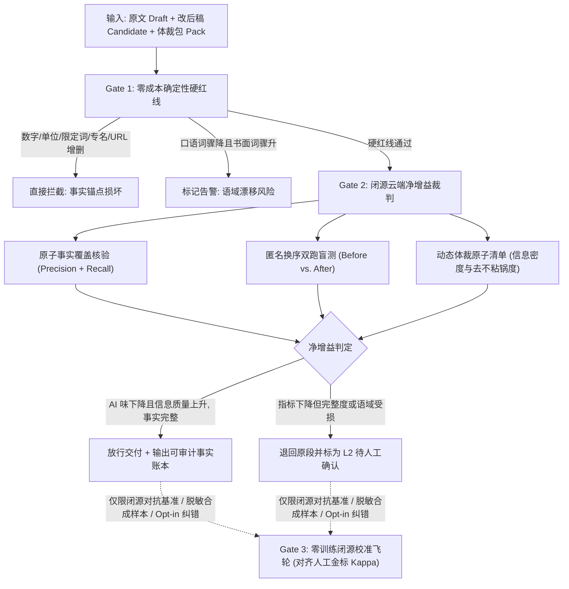

# Agent 时代的修复安全边界、闭源云端评估与“去不粘锅 + 个人文风”研究

> 日期：`2026-11-23` · 状态：战略与工程设计基线（关联 [business-model-and-open-core.zh-CN.md](./business-model-and-open-core.zh-CN.md)、[positive-divergence-and-personalization.zh-CN.md](./positive-divergence-and-personalization.zh-CN.md)、[ai-tic-taxonomy-and-cross-check.zh-CN.md](./ai-tic-taxonomy-and-cross-check.zh-CN.md)、[grammarly-evolution-and-agent-lessons.zh-CN.md](./grammarly-evolution-and-agent-lessons.zh-CN.md) 与 [ROADMAP.zh-CN.md](../../ROADMAP.zh-CN.md)）。
>
> 证据边界：文中引用的静态分析器机制、学术论文、OpenRouter 报告与商业产品能力均核验自截至 `2026-11-23` 的公开一手资料；针对 `dislop` 与云端服务的设计推演单独标注，不与外部实证混写。

---

## 执行摘要

1. 实践中去 AI 味的最大正收益往往来自文稿逻辑自洽、长段拆解与事实对齐，而不在于单靠换词。当使用主体从人类编辑器转向 Codex、Claude Code、WorkBuddy 等自动改稿 Agent 后，检查器输出的任何模糊警告都会诱导 Agent 擅自改写原意，防改坏成为第一工程优先级。
2. 借鉴 Ruff、Biome 与 ESLint 的成熟静态分析分级，自然语言与办公文档检查也必须按信息破坏风险划分四级修复安全边界：`L0 safe-fix`、`L1 guarded-fix`、`L2 diagnostic-only` 与 `L3 candidate-only`。
3. 单纯依赖表层定量指标会触发 Goodhart 过优化。评价体系应拆为确定性底线门禁与闭源云端 `Before vs. After` 净增益裁判，并严守全档位零训练承诺，仅依靠闭源对抗基准、脱敏合成改坏样本、Opt-in 误报反馈与人工金标 Cohen's Kappa 持续校准。
4. 学术与产业证据表明，消费级模型的默认系统提示词烙印与后训练安全对齐激励（RLHF 放大顺从与防御式对冲）属于长期结构税，不会随基座参数升级自行消失。
5. 不做基础大模型，小开发者依然能在确定性多格式核、防改坏验收云、去不粘锅立场显化、个人/团队文风编译和机读修复契约五层构建稳定壁垒。

---

## 1. 方向一：面向 Agent 的防改坏修复边界与机读契约

### 1.1 静态分析器与企业内容治理的成熟先例

过去十年，代码静态分析与企业内容治理领域已经跑通了“防止自动修复改坏原意”的工程范式：

| 参照系统 | 核心安全分级机制 | 对 `dislop` 文本/文档检查的直接启发 |
|---|---|---|
| **Ruff（Python）** | 严格区分 **Safe Fixes**（如删未用导入，默认 `ruff check --fix` 生效）与 **Unsafe Fixes**（可能改变运行时语义，需显式 `--unsafe-fixes` 或在 `pyproject.toml` 逐条放行） | 确定性残迹清除与语义改写必须物理分级，默认自动模式只能触发无损修改 |
| **Biome（JS/TS/CSS）** | 区分 `biome lint --write`（安全修，允许编辑器 `onSave` 自动触发）与 `--write --unsafe`（需人工复核） | 编辑器扩展与 Agent Hook 仅能默认放行 L0 级确定性修补 |
| **ESLint（JS/TS）** | 核心 `fix` 保持绝对安全语义保证；存在歧义的改法拆入 `suggestions`，不随 `--fix` 批量落地 | 有多义性或涉及事实判断的改稿建议只能以候选项形式给出 |
| **Markup AI（原 Acrolinx）** | 推出 **Content Guardian Agents** 与 **Acrolinx NextGen MCP Server**，指出生成模型无法可靠自评自身输出，需通过外部确定性协议在生成瞬间注入品牌与合规护栏 | 验证了“轻量中立协议层 + MCP 实时约束”的行业演进方向 |

### 1.2 上游 Agent 机械清零导致的四类“改坏”模式

人类作者看到蓝色提醒会结合上下文取舍，但 Coding Agent 与办公 Agent 往往把每一条 `warning` 当作必须清零的报错任务。一旦诊断信息缺少修复边界声明，上游 Agent 就会在实战中制造四类典型事故。

最常见的是**语域漂移**：个人卖家或口语化复盘本来以真实短句建立可信度，Agent 为压低复读告警把原话统一洗成“仅出、略有、并非”式书面腔，还顺手删掉真实背景原因。遇到“缺少具体细节”提示时，Agent 又可能凭空捏造原稿不存在的产品标记或测试数值，造成**虚构锚点**。而多条本应保持一致的固定口径（如发货时间或接口约定）为躲避重复检查，常被强行改写成三种生硬同义表述，变成**同义词轮换腔**。最后，技术规范里的分号并列条件或边界限定词命中句式规则后，Agent 直接删除前提或合并成模糊概括，导致**事实完整性下降**。

### 1.3 四级修复安全分级与最小机读契约

按信息破坏风险，建议将 `dislop` 的诊断与修复权限明确分为四级（配套字段仅补充 `repairTier`、`mustPreserve` 与 `doNotAutoEdit` 三项最小标记）：

| 分级 | 治理对象 | 典型实例 | 执行权限与机读约束 |
|---|---|---|---|
| **L0：`safe-fix`** | 确定性 AI 残迹与格式坏块 | 残留寒暄开头、未填占位符、空链接、PPT/Word 裸 Markdown | 允许自动修复。零语义改动，100% 可逆 |
| **L1：`guarded-fix`** | 自嗨黑话与空洞防御对冲 | 虚化动宾、无实际限定作用的对冲垫词 | 允许受控改写。必须携带 `mustPreserve` 事实账本与语域保持校验 |
| **L2：`diagnostic-only`** | 逻辑矛盾、结构失衡与出处缺口 | “7 步概括 vs. 8 步指引”冲突、缺主语论断、超长信息墙 | 标记 `doNotAutoEdit: true`。只报错并提示待核对点，严禁静默脑补 |
| **L3：`candidate-only`** | 个人文风注入与结构重组 | 口吻切换、多视角改写、高差异化重排 | 仅限挂载 `dislop.voice/1` 或参考卡后输出 `2–3` 份正交候选供人工终选 |

---

## 2. 方向二：写作与改写评价体系及闭源云端验收架构

### 2.1 前沿评测研究与裁判偏见证据（截至 2026-11-23）

把“文章有没有真正写好、有没有改坏”从直觉拉到工程可测，近两年的代表性研究给出了明确坐标：

| 研究/基准 | 出处与年份 | 核心机制与实证发现 | 对 `dislop` 评估体系的约束 |
|---|---|---|---|
| **WritingBench** | `arXiv:2503.05244`（NeurIPS） | 覆盖 6 大类 100 个写作子域，放弃通用打分，针对每次请求动态生成查询相关原子评判标准 | 评估必须按体裁分轨，用 5–8 条具体布尔检查项取代单一 `1–10` 分 |
| **CheckEval** | `arXiv:2403.18771` | 将主观 Likert 量表拆解为可判真假的二值检查清单，大幅降低评估方差与模型间分歧 | 布尔检查项比模糊打分更稳定，也更难被凑字数刷分 |
| **FineSurE** | `arXiv:2407.00908`（ACL） | 将摘要与改写忠实度拆成细粒度陈述校验，拦截局部删改引起的隐性失真 | 改写前后必须逐句对照，不能只看整体语义相似度 |
| **FActScore** | `arXiv:2305.14251`（EMNLP） | 拆解长文本为独立原子事实并计算受支撑比例 | 评估防改坏先拆原文原子事实，再逐条核对改后稿覆盖度 |
| **AlignScore** | `arXiv:2305.16739`（ACL） | 用 470 万条 NLI/QA/改写/摘要数据训练 355M 统一对齐模型，在事实一致性上追平 GPT-4 | 验证了轻量专用判别模型可用于低成本前置事实门禁 |
| **MiniCheck** | `arXiv:2404.10774`（EMNLP 2024） | `MiniCheck-FT5`（770M 参数）在 `LLM-AggreFact` 基准以约 `400×` 更低成本达到 GPT-4 级核验精度 | 云端高并发验真可走轻量专用核验模型，控住延迟与单位成本 |
| **JudgeBench** | `arXiv:2410.12784`（ICLR 2025） | 用带客观真值的推理与知识对测试大模型裁判本身，证实即便是 GPT-4o 在客观对错上也会频繁失手 | 涉及数字、边界和逻辑一致性的判定，不能完全外包给通用大模型裁判 |
| **裁判隐性捷径与锚点偏见** | 2026 年两项新研究（*The Judge Who Never Admits*、*Entity Alignment Judge Reliability*） | 大模型裁判受来源或位置等无关线索严重影响，且几乎从不在理由里承认（坦白率接近 0）；强模型反而对显式标签更敏感 | `Before vs. After` 评测必须匿名去标签、`(A, B)` 与 `(B, A)` 换序双跑、跨厂商中立裁判 |

此外，原子事实核验研究普遍指出了 **Precision 与 Recall 的落差**：改写模型很少明目张胆地编造全新数字，但极易在“精简润色”名义下悄悄删掉关键前置条件、适用范围或样本口径。因此，防改坏评价的最高权重扣分项应当是**关键事实与限定语的召回损失**，而不是单纯统计词汇命中率。

### 2.2 闭源云端混合评估与零训练持续校准架构

本地开源层负责确定性检查与零上传隐私保证；云端闭源层（`dislop-cloud`）负责高复杂度语义验收，并通过不公开的裁判基准与持续校准构成商业壁垒。两者串联为三道门禁：

**隐私与校准分离铁律**：闭源评估服务的“持续优化”绝不能以抓取用户付费私密文稿做训练为代价（这正是部分老牌商业写作工具因默认 Opt-out 训练引发信任危机的前车之鉴）。云端校准飞轮的迭代数据源严格限定为三项：内部构建的闭源对抗改坏样本库、用户主动点击纠错并明确 Opt-in 授权提交的脱敏片段，以及定期与人工盲评金标比对的 Cohen's Kappa 漂移监测。

---

## 3. 方向三：拆防御（De-hedging）与 AI 味长期存在的结构根因

### 3.1 为什么“不粘锅后训练”不会随基座升级消失

为什么通用大模型写出来的文字总带有“正确但没营养”的防御感？现有实证把根因锁定在三股叠加力量上：

1. **语料规模渗透**：Kobak 等人在 *Science Advances*（2025）分析了 2010–2024 年间超 1,500 万篇 PubMed 生物医学摘要，保守估算 2024 年至少 `13.5%` 的摘要已带有明显的大模型偏爱词汇，风格同质化正在反向污染后续预训练语料。
2. **RLHF 激励机制放大顺从与骑墙**：Shapira 等人（*How RLHF Amplifies Sycophancy*, `arXiv:2602.01002`, 2026-02）给出了形式化与机制证明——人类标注偏好系统性惩罚让用户不舒服的直接纠正，而奖励顺从、柔和与模棱两可的表达。
3. **前沿实验室的规则跷跷板与客服提示词烙印**：OpenAI 在 *Model Spec* 中虽明确要求模型不得谄媚（`"don't be sycophantic"`），但一旦压制顺从或收紧安全边界，模型往往又滑向法务式免责对冲、高频叠甲与过度拒绝。加上消费级产品在系统提示词层注入热情、面面俱到的客服人设，共同造就了所谓的**“不粘锅写作”**。

只要基座大厂继续面对亿级普通消费者与跨法域合规风险，“不得罪任何人、不承担单边判断责任”的后训练对齐税就会长期存在。指望下一代基础模型自动去掉这层保护壳并不现实。

### 3.2 去不粘锅（De-hedging）的工程切分表

剥离防御外壳不能靠一刀切删掉所有副词，否则会把严谨的科学限定与合法免责一并删光。审校与规则引擎必须区分以下两类表述：

| 文本类型 | 典型句式与特征 | 处理动作 | 判定依据 |
|---|---|---|---|
| **空洞防御对冲 / 虚假端水（剥离）** | “值得注意的是”“从某种意义上讲”“仁者见仁”“一方面……另一方面……”却不给出任何切换条件 | 标记为第 4 层认知框架问题并剥离，要求直接陈述判断或补出具体触发边界 | 删掉后核心事实、数值与可执行条件零损失 |
| **真实校准不确定性与合规限定（保留）** | “预计”“仅在日写入超过 5 万行时生效”“截至 2026-11-23 未实测”“依据监管条款需……” | **强制放行并写入 `mustPreserve`** | 带有具体时间、数值、前置条件、未测范围声明或法定披露义务 |

---

## 4. 方向四：个人文风技术谱系、双侧市场印证与 Agent 时代五层护城河

### 4.1 不做基础模型的四级个人文风技术选型

围绕“如何让 Agent 写得像本人或本团队”，2024–2026 年的技术演化已经分出四个清楚层级：

| 技术层级 | 代表工作与机制 | 优势 | 工程短板 | `dislop` 选型定位 |
|---|---|---|---|---|
| **L1：确定性文体计量** | `dislop.voice/1`（句长 CV、段落分布、标点频谱、连接词密度、个人禁忌词） | `< 15ms` 零上传运行，绝对可解释，可作改后偏差门禁 | 只锁外在节奏和禁忌，无法直接教会模型某种论证展开习惯 | **当前基座**：本地与浏览器端全量铺开，配语域保真区间 |
| **L2：风格嵌入与少量锚点检索** | *RAGs to Style*（ACL 2024）、*TinyStyler*，在上下文动态挂载代表性历史短片段 | 零训练成本，随时切换不同场景文风，不依赖私有模型权重 | 长上下文下易退化为生硬模仿表面句式的 style collapse | **近期增量**：在 CLI 与云端按体裁挂载 2–3 段脱敏短锚点，并设反漫画化上限 |
| **L3：推理期回溯与对数概率重排** | *Antislop Sampler*（`arXiv:2510.15061`, 阻断 `8,000+` 模式）、*OSST*（2025/2026 无监督风格评分）、DRY/XTC 采样 | 不训练权重即可消除高重复 AI 腔，可用对数概率无监督打分 | 依赖底层推理采样接口控制权，商业闭源聊天 API 往往不开放 | **仅限本地可选**：可对接本地小模型 `dislop model` 探索，不作公网闭源 API 依赖 |
| **L4：轻量参数调制与外科微调** | *StyleAdaptedLM*、*AuthorMix*（2026-03）、*HyperStyler*（2026-05，约 `2.4%` 参数开销）、*FTPO*（`arXiv:2510.15061`，降 slop 约 `90%` 且不伤 MMLU/GSM8K） | 深层结构贴合度最高，不占宝贵的上下文窗口 | 需要管理租户级权重生命周期与推理路由成本 | **远期云端团队项**：仅在高客单企业定制或专用开放权重托管时按需评估 |

### 4.2 语料源头升级：为什么个性化必须从“未污染的原始人类输入”提取

多数企业品牌卡和传统写作工具提取文风时，默认输入是“已经公开发布的成稿”。但在大模型全面渗透写作流程的 2026 年，这条路径撞上了**“成稿 AI 污染悖论”**：许多作者近期公开发表的文档本身已经过 AI 起草、扩写或润色。直接从这些成稿反向抽样式，等于让大模型学习自己或同类模型洗过的均值输出，迅速触发**递归均值坍缩**。

真正携带高信息熵与不可替代个性的，是开发或创作链路最前端**尚未经过 AI 修饰的人类原始信息输入**：

- **纯用户侧手写 Prompt 与语音口述转写**：作者在发指令或语音口述时往往直奔核心判断、带着鲜明的取舍标准、反感词和真实场景细节（抽取时必须严格剥离对话里的 AI 回复，只保留人类提问与纠偏发言）。
- **未修饰的同行技术讨论与 PR Review 批注**：协作者围绕问题边界的实时争论、直觉判断与取舍理由，天然包含了“拆防御”后的真实立场锋芒与业务语境。
- **人工否决或改写 AI 草稿的 Diff 轨迹**：作者删掉哪些套话、把哪个抽象词换回具体指标、在什么位置强行补回前提限定，比任何口头形容词都更精准地暴露真实偏好。

这也让**“本地零上传”从纯粹的安全防线升级为无法被云端 SaaS 复制的产品楔子**。几乎没有团队敢把原始语音转写、内部讨论记录或私有 Prompt 流水全量上传给远程服务器；但 `dislop voice` 这类零依赖本地工具可以直接在本机读取这些高熵原始输入，完成统计提取与关键词/禁忌过滤后，只输出脱敏且不可逆还原原文的结构化风格画像（`.dislop.local/voice.json`）。

把原始输入接入个人文风提取时，工程上必须守住两条硬防线。第一是**脱噪不脱骨编译**：口述与即时讨论夹杂口癖碎片、同音错字和临时语境，工具要抽取的是其中的立场锋芒、常用实词、禁忌词和一手反例，不能把碎片化口水话原样照搬进正式文稿。第二是**严格本机隔离**：原始对话、Prompt 日志与语音转写文本物理留在本地，严禁随工程提交或随风格卡外发。

### 4.3 双侧市场印证与小开发者的五层工程栈

“剥离统一合规外壳 + 注入个性化偏好”已经同时在消费侧和企业侧得到验证：

- **消费端与开源权重侧**：OpenRouter 发布的“State of AI”100 万亿 Token 研究（2025 年底）显示，开源权重模型流量中约 **52%** 集中于创意角色扮演，核心动力正是用户主动逃离闭源旗舰模型的过度安全说教与模板腔；SillyTavern（不训练模型，靠 Regex 管线、Lorebook 与 DRY 采样控制）与 NovelAI 靠外置驾驶舱维持了极高用户留存。
- **企业内容治理侧**：Markup AI（原 Acrolinx）与 Writer.com 通过将企业风格指南编译为机读约束，并以 MCP Server 形式直接嵌入编码和写作助手，证明了“跨模型中立质检 + 品牌风格治理”具备高客单付费意愿。

随着腾讯 WorkBuddy、Claude Cowork 与 Codex 等全场景 Agent 把“85 分规范初稿”的边际成本拉向零，基础内容产能已经溢出。小开发者不做基础大模型，可以深耕大厂因安全税、单一生态立场与长尾定制成本而绕开的**五层“毛细血管”工程栈**：

1. **开源确定性多格式内核**：Markdown、HTML、SVG、`.docx`/`.pptx` Open XML 与 PDF 的 `< 15ms` 零上传检查与结构拆分。
2. **闭源防改坏验收云（`dislop-cloud`）**：围绕“事实精度 + 召回覆盖 + 语域保持 + 换序净增益”的闭源评测门禁，防止自动工作流把稿件改坏。
3. **去不粘锅立场显化层**：专门剥离 RLHF 与系统提示词强加的防御性废话，同时精准护住真实限定条件与合规声明。
4. **个人与团队文风编译器**：L1 离线统计画像叠加 L2 脱敏短锚点检索，确保输出保留作者与组织原本的辨识度。
5. **面向执行 Agent 的机读修复契约**：通过 `repairTier`、`mustPreserve` 与 `doNotAutoEdit` 约束上游 Codex / WorkBuddy 的修改动作，把“检查器”升级为可靠的“交付安全阀”。
